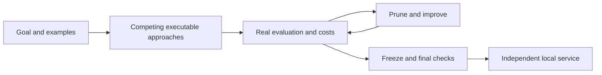

# Solve2Ship Skills — From Goals to Working AI Solutions

[English](README.md) · [简体中文](README.zh-CN.md) · [Solve2Ship engine](https://github.com/runzhiyyds/solve2ship)

**Tell your local agent what you need. Let solutions compete. Get a usable service.**

Solve2Ship Skills is an open-source, installable skill for local coding agents. It
brings the **Goal-to-Service** approach to a conversation: define a business outcome,
compare executable technical approaches, evaluate real results, prune and improve
under a budget, then deliver an independently callable local solution. No STS
frontend or user-designed workflow is required.

The technical idea is simple: **AI should explore how to solve a problem, not only
execute a workflow designed by a person.** Rules, scripts, ML, prompts, workflows
and agents are alternatives. A small program is allowed to beat a complex agent.

**v0.2.0 preview.** This is an agent skill with tested evidence/install/package
helpers, not a standalone autonomous engine, sandbox or model service. Task quality
still depends on the agent, available resources and valid evaluation. Framework
selection guidance is not a claim of implemented LangGraph/Dify integrations.

## Start without technical knowledge

Tell your installed local agent:

> Use $solve2ship. I have customer messages and want refund, delivery or other
> categories. Compare suitable approaches, test the results and give me something
> I can use locally. Explain choices in plain language. Do not make paid calls.

Provide examples and one description of the desired outcome. Per-example labels
are optional. The agent should inspect resources, ask only essential questions and
handle technical choices. It must tell you when a paid service or safe execution
runtime is missing. It cannot grant itself API access, cloud rights or a budget.

Try the [customer-routing example](docs/EXAMPLE.md) with [20 unlabeled synthetic
messages](examples/customer-routing.json). It includes a zero-paid local request and
an honest forward-test summary, with quality review still required.

Already have STS running locally? The packaged [headless bridge](docs/HEADLESS.md)
lets your agent use its actual task/search/review/delivery APIs without opening a
frontend. It is read-only by default and never creates a model budget or installs
an engine. Full review/readiness commands target STS v0.14; v0.13 remains read-only.
The v0.2 install ZIP was checked outside both repositories against a real local
STS v0.14 engine: Chinese status, four closed final-review cases and an accepted
Rules service download with a matching SHA256. The bridge made no model calls,
submitted no review votes and did not execute the downloaded service.

## Install

Download the repository ZIP from GitHub or clone it. You can give the folder to
your local agent and say: “Install this Solve2Ship skill for me; preserve any existing
different version.” Review the source and the host's requested permissions, then let
the agent handle the installation. The manual alternative follows. Python 3.10+ is needed only
for the optional helper/installer scripts; the instructions are plain Markdown.

```sh
git clone https://github.com/runzhiyyds/sts-skills.git
cd sts-skills
python3 scripts/install_skill.py --agent codex
# Or: python3 scripts/install_skill.py --agent claude
```

Reload skills/restart your agent as required by that host. Hosts have different skill
support; check their current documentation. For another host, copy `skills/solve2ship/`
to its supported skill directory, or use `--destination /path/to/skills`.
An existing different skill is preserved; the installer refuses silent overwrite.

A release ZIP contains the `solve2ship/` skill folder with checksums, LICENSE and
NOTICE. Unpack it into the host's supported skills directory. A checksum verifies
file integrity, not the quality or security of every solution an agent may create.

## What happens



The skill keeps evidence sources separate: provided labels, executable checks,
uncalibrated model judges and human feedback. Final holdouts are not reused for
optimization. Generated code/model loading requires suitable isolation; no host
execution fallback. Keys and private datasets stay out of source distributions;
authorized task data may be sent to the configured model provider. Unknown charges remain reserved,
and failed/ambiguous paid operations are never automatically replayed.

## Documentation

- [Skill workflow](skills/solve2ship/SKILL.md)
- [Headless STS bridge](docs/HEADLESS.md)
- [Resources and isolation](skills/solve2ship/references/execution.md)
- [Approach selection](skills/solve2ship/references/adapters.md)
- [Evaluation and durable evidence](skills/solve2ship/references/evaluation.md)
- [Independent delivery](skills/solve2ship/references/delivery.md)
- [FAQ](docs/FAQ.md), [dependencies and license scope](docs/DEPENDENCIES.md)
- [Reusable sharing material](docs/SHARING.md), [contributing](CONTRIBUTING.md)

## Verify and package

```sh
python3 -m unittest discover -s tests -v
python3 scripts/package_skill.py
```

The v0.2 suite passes 31 stdlib tests, including 20 local HTTP protocol tests for
the bridge. These exercise helpers and packaging. They do not establish task accuracy,
general optimization gains or production security. Public/production hosting,
framework/model downloads and external fees require separate authorization and real
acceptance. See the [STS engine](https://github.com/runzhiyyds/solve2ship) for its own
versioned implementation/evidence; this skill does not silently install it.

## License and citation

[Apache-2.0](LICENSE). Copyright 2026 郭辰远 (Chenyuan Guo). Preserve [NOTICE](NOTICE).
External models, frameworks and runtimes retain their own terms. Cite the project
using [CITATION.cff](CITATION.cff); no peer-reviewed method or novelty claim is made.
